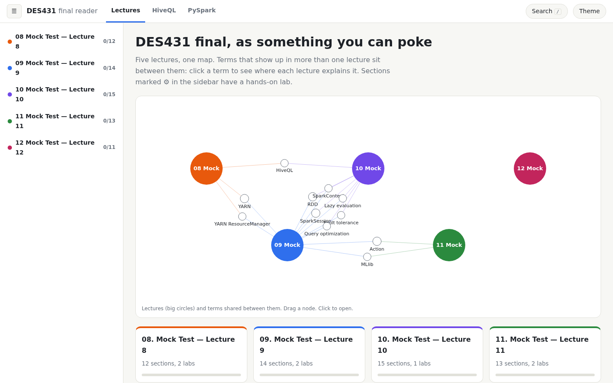

# DES431 Final Reader

Interactive reader for the DES431 Big Data Analytics final: lectures 08 to 12 (Hive, Spark streaming, Spark ML, data visualization) plus HiveQL and PySpark tutorials, with a term map, search, glossary and hands-on labs.

**Live site: https://toonzzzrock.github.io/big-data/**



## Run locally

```
npm install
npm start          # rebuilds, then serves dist/ at http://localhost:4173
```

`dist/index.html` also opens directly from disk.

## Build

```
npm run build      # ../summarize/*.md -> dist/data.js, copies src/* into dist/
npm test
```

The build reads `../summarize/`, which is not in this repo, so `dist/` is built locally and committed.

## Deploy

`.github/workflows/pages.yml` publishes the committed `dist/` to GitHub Pages on every push to `main`. Rebuild before committing so the site matches the summaries.
